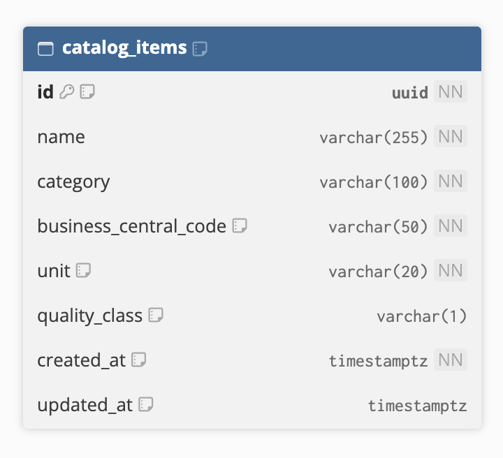

# Food catalog

The catalog is the list of foods Moisson Montréal can receive. Each row is one kind of food. A donation of that food points at the row, and the price grid stores the price of one unit over time. Accounting matches the row through its Business Central code.

food_items is one donation: the donor, the quantity and the date. catalog_items is the food itself.

## Diagram

The columns in this picture are the catalog item. The quality class column is a link to the quality_classes table: it stores the class code, such as A, B or C. The full database diagram in [schema.md](schema.md) shows that link together with the price grid.

## Tables

### catalog_items

One row per kind of food. The table was created for the price grid, and these columns complete it.

- **id**: code that identifies the catalog item, assigned automatically
- **name**: name of the food, for example Pain
- **category**: group the food belongs to, for example Boulangerie
- **business_central_code**: code of this food in Business Central. Two catalog items cannot share a code
- **unit**: unit used to count the food, such as kg or caisse. Free text for now, until issue #28 decides how the price of one unit works
- **quality_class**: quality class of this food, such as A, B or C. When it is set, it must be a class that exists. It is empty until someone picks it, as for items imported from Business Central. The class is stored on the catalog item
- **created_at**: date and time the item was added, stored in UTC
- **updated_at**: date and time of the last change, stored in UTC. Empty until the item is edited

## Quality class

The quality class belongs to the catalog item, so every donation of that food can use the same class. The classes and their percentages live in the quality_classes table. A catalog item can only use a class that is already there. Its class can also stay empty: no class is given by default, because a forgotten default would put the wrong value on a receipt.

A donation still keeps the quality class it was given, on food_items. That value is what a receipt uses.

## Business Central code

The code is how the catalog item is matched with the accounting system. The database rejects a second item with the same code. The comparison is exact, so `BC-PAIN` and `bc-pain` are two different codes.

## Rules enforced by the database

1. A name, a category, a Business Central code and a unit cannot be empty.
2. A Business Central code can belong to only one catalog item.
3. When it is set, the quality class must be a quality class that exists. It can be empty.
4. A quality class cannot be deleted while a catalog item uses it.

## API

List, create and edit are available at `api/catalog-items`. Any signed-in employee can list the catalog. Creating or editing an item requires the ManagePriceGrid permission, so only an Admin can do it. Creating or editing an item with a Business Central code that is already used returns a conflict. A quality class that does not exist is refused. Creating or editing an item by hand always requires a quality class, so editing an item is how someone picks the class of an imported item. The list can return items with an empty class.

## Import from Business Central

`POST api/catalog-items/import` receives an Excel export of Business Central (a .xlsx file in a form field named `file`, 10 MB at most) and creates or updates catalog items by their Business Central code. Like creating an item, it requires the ManagePriceGrid permission.

- The file is the item list exported from Business Central (Liste des articles): an `Articles` sheet with the columns `N°`, `Description`, `Type` and `Unité de mesure de base`. Columns are found by name, so their order does not matter, and the other columns are ignored. Only items of type `Inventaire` are imported. An item of another type is reported.
- The costs in the export (`Coût unitaire`) are not imported. They are an internal value, not the fair market value a receipt needs, and prices are entered in the price grid instead.
- A new code creates an item. Since the export has no category, the item gets the category `To classify`, to be corrected by hand. It has no quality class either, and its class stays empty until someone picks it: no default is given, because a forgotten default would put the wrong value on a receipt.
- A known code only updates the name. The category and the quality class are never changed by an import, so manual corrections are kept.
- The unit is never changed by an import either. Prices are per unit, so changing the unit of an item would silently change the meaning of all its prices. A line whose unit differs from the item's unit is reported, and the item is left unchanged. Units are compared without regard to upper or lower case, so kg and KG are the same.
- Importing the same file again creates no duplicates.
- A line that cannot be imported is listed in the report with its row number and the reason. The other lines are still imported.
- A file that cannot be read at all (not an .xlsx file, no `Articles` sheet, a missing column, too large) is refused with a message that explains why.
- If another request adds an item with one of the file's codes at the same time, the import returns a conflict, like creating an item with a code already used. Nothing from the file is saved, and importing the file again works.

Code: [CatalogImportController.cs](../../src/MoissonMontreal.Api/Controllers/CatalogImportController.cs), [BusinessCentralExportReader.cs](../../src/MoissonMontreal.Api/Catalog/BusinessCentralExportReader.cs) and [CatalogImporter.cs](../../src/MoissonMontreal.Api/Catalog/CatalogImporter.cs).

## Migration

- Entity Framework migration: [20261117040905_AddCatalogItemDetails](../../src/MoissonMontreal.Api/Data/Migrations/20261117040905_AddCatalogItemDetails.cs)
- Equivalent SQL script: [0006_add_catalog_item_details.sql](sql/0006_add_catalog_item_details.sql)
- Table settings: [CatalogItemConfiguration.cs](../../src/MoissonMontreal.Api/Data/Configurations/CatalogItemConfiguration.cs)
- API: [CatalogItemsController.cs](../../src/MoissonMontreal.Api/Controllers/CatalogItemsController.cs)

Catalog items that existed before this migration get placeholder values, so the new rules can be added: category `To classify`, Business Central code `TO-FIX-` followed by the item id, unit `unit` and quality class A. Fix these items by hand after the migration.

The SQL script must be run after [0005_create_quality_classes.sql](sql/0005_create_quality_classes.sql). It records itself in the migration history, so Entity Framework will not apply it a second time.

### Optional quality class

- Entity Framework migration: [20261120031640_MakeCatalogItemQualityClassOptional](../../src/MoissonMontreal.Api/Data/Migrations/20261120031640_MakeCatalogItemQualityClassOptional.cs)
- Equivalent SQL script: [0007_make_catalog_item_quality_class_optional.sql](sql/0007_make_catalog_item_quality_class_optional.sql)

This migration lets the quality_class column be empty, so items imported from Business Central keep an empty class until someone picks it. Existing items keep their class. A class that is set must still exist.

Rolling it back makes the class required again. It stops with a clear error, and changes nothing, while a catalog item has no class: pick a class for each of them first. A class is never guessed.

The SQL script is generated from the migration with `dotnet ef migrations script AddCatalogItemDetails MakeCatalogItemQualityClassOptional --project src/MoissonMontreal.Api --output docs/database/sql/0007_make_catalog_item_quality_class_optional.sql`, and the byte order mark (BOM) at the start of the generated file is removed. It must be run after [0006_add_catalog_item_details.sql](sql/0006_add_catalog_item_details.sql).
