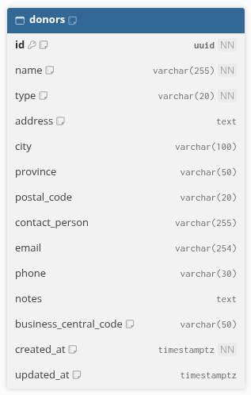

# Donor profiles

A donor is a person or an organization that gives food to Moisson Montréal. Donations are grouped by donor, totals are calculated per donor, and each tax receipt is issued to a donor. The profile holds what is needed to identify the donor and to print the tax receipt later.

## Diagram

The diagram is generated from [donors.dbml](donors.dbml). To update it, paste the content of that file into [dbdiagram.io](https://dbdiagram.io) and export the image.

## Tables

### donors

One row per donor. The table was created with the donations, and these columns complete the profile.

| Column | Meaning |
| --- | --- |
| id | Code that identifies the donor, assigned automatically |
| name | Full name of a person, or name of an organization |
| type | individual or organization. The two are named differently on a tax receipt |
| address | Street address, such as 123 rue Saint-Laurent |
| city | City, such as Montréal |
| province | Province, such as QC |
| postal_code | Postal code, such as H2X 1Y4 |
| contact_person | Person to contact at the donor |
| email | Email of the donor |
| phone | Phone number of the donor |
| notes | Free notes about the donor |
| business_central_code | Code of the donor in Business Central, used by the import. Empty if the donor has none |
| created_at | Date and time the donor was added, stored in UTC |
| updated_at | Date and time of the last change, stored in UTC. Empty until the donor is edited |

## Address on the receipt

The name, the street address, the city, the province and the postal code are what a tax receipt prints for the donor. **This is still to be confirmed with Nafissa.** There is no country column, since donors are in Canada.

## Required fields

The API refuses a donor without a name, a type, a street address, a city, a province or a postal code. It returns one message per field that has a problem. Every field is trimmed, an empty optional field is stored as empty (null), and an email must be a valid email address.

In the database, only the name and the type are required. The address columns can stay empty, so the donors that existed before this change and the donors brought in later by the Business Central import (#78) are not refused.

## Business Central code

Donors imported from Business Central keep their Business Central code. Two donors cannot share a code, and the comparison is exact, so `C-100` and `c-100` are two different codes. Many donors can have no code.

## Rules enforced by the database

1. A name cannot be empty.
2. The type is individual or organization.
3. A Business Central code can belong to only one donor, and cannot be empty when it is set.
4. A donor cannot be deleted while they have food items or receipts.

## API

| Action | Request | Who can do it |
| --- | --- | --- |
| View a donor | GET `api/donors/{id}` | Any signed-in employee |
| Create a donor | POST `api/donors` | ManageDonors: Supply, Supply Director and Admin |
| Edit a donor | PUT `api/donors/{id}` | ManageDonors: Supply, Supply Director and Admin |

- A donor id that does not exist returns 404.
- A missing or invalid field returns 400, with one message per field.
- A Business Central code that another donor already uses returns 409.

The donor screen of the desktop app is temporary. It opens a donor by its id, creates a donor and edits it. It works once the desktop app signs in with Entra ID (#09). The list of donors and the search by name come in a later issue.

## Migration

| Item | Location |
| --- | --- |
| Entity Framework migration | [20261118185010_AddDonorProfile](../../src/MoissonMontreal.Api/Data/Migrations/20261118185010_AddDonorProfile.cs) |
| Equivalent SQL script | [0007_add_donor_profile.sql](sql/0007_add_donor_profile.sql) |
| Table settings | [DonorConfiguration.cs](../../src/MoissonMontreal.Api/Data/Configurations/DonorConfiguration.cs) |
| API | [DonorsController.cs](../../src/MoissonMontreal.Api/Controllers/DonorsController.cs) |
| Validation | [DonorValidator.cs](../../src/MoissonMontreal.Api/Donors/DonorValidator.cs) |

Donors that existed before this migration get the type organization, and their new columns stay empty. Check their type and complete their address by hand after the migration. The default of the type column is then removed, so a new donor must state its type. This step is written by hand in the migration. Keep it if the migration is ever regenerated.

Rolling the migration back removes the new columns and keeps the donors with their name, address, postal code and contact person.

The SQL script is generated from the migration with `dotnet ef migrations script AddCatalogItemDetails AddDonorProfile --project src/MoissonMontreal.Api --output docs/database/sql/0007_add_donor_profile.sql`. It must be run after the scripts 0001 to 0006. It records itself in the migration history, so Entity Framework will not apply it a second time.

The generated file starts with a UTF-8 byte order mark (BOM). Remove it before committing, for example with `sed -i '1s/^\xEF\xBB\xBF//' docs/database/sql/0007_add_donor_profile.sql`.
