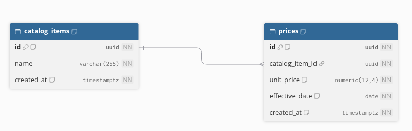

# Price grid

These two tables hold the price grid: the types of food the app knows, and the price of one unit of each type over time. Each price has an effective date, so a past donation can always be valued at the price that applied on the day it was received.

## Diagram

The diagram is generated from [prices.dbml](prices.dbml). To update it, paste the content of that file into [dbdiagram.io](https://dbdiagram.io).

## Tables

### catalog_items

One row per type of food, such as bread or apples. A donation of bread and the next donation of bread are two different rows in food_items, but they share one catalog item, and so one price history.

| Column | Meaning |
| --- | --- |
| id | Code that identifies the catalog item, assigned automatically |
| name | Name of the food. It cannot be empty. |
| created_at | Date and time the item was added, stored in UTC |

This is the smallest catalog the price grid needs. Issue #27 adds the category, the Business Central code (which will be unique), the unit and the quality to this same table. Until then, two catalog items can have the same name.

### prices

One row per price of a catalog item.

| Column | Meaning |
| --- | --- |
| id | Code that identifies the price, assigned automatically |
| catalog_item_id | The catalog item this price belongs to (see the catalog_items table) |
| unit_price | Price of one unit of the item, in dollars, with up to 4 decimal places. For example, $0.125 per kg. |
| effective_date | First day the price applies |
| created_at | Date and time the price was entered, stored in UTC |

## How a price history works

A price is never replaced. When the price of an item changes, a new row is added with the date the new price starts. The earlier rows stay as they are.

For example, the price history of bread:

| effective_date | unit_price |
| --- | --- |
| 2026-11-01 | $4.00 |
| 2026-12-01 | $4.25 |
| 2027-01-01 | $3.90 |

The price that applies on a given day is the one with the latest effective date on or before that day:

| Donation received on | Price used |
| --- | --- |
| 2026-11-15 | $4.00 |
| 2026-12-01 | $4.25, since a price applies from its effective date itself |
| 2027-03-10 | $3.90 |
| 2026-10-20 | None, since it is before the first price. The app must show a clear error instead of guessing. |

Looking up the price for a date is done by the app, in issue #25.

## Prices on the grid and prices on receipts

The price is stored in two places on purpose, with two different roles:

- **prices** is the reference grid, maintained by the admin, with its full history.
- **receipt_items.unit_price** is a copy of the price taken when the receipt is calculated, so a receipt never changes after it is made. This is what the PRD calls a price "frozen in the transaction".

Adding a new price to the grid therefore never changes a receipt that already exists.

## Units and precision

- A price is for one unit of the catalog item, for example 1 kg or 1 case. The unit itself is added to catalog_items in issue #27, following the decision of issue #28.
- unit_price keeps 4 decimal places, the same as receipt_items.unit_price, so a price can be copied onto a receipt without losing anything.
- A price with more than 4 decimals is rounded half away from zero by the database. For example, $0.12345 is stored as $0.1235.
- The largest price allowed is $99,999,999.9999. A larger value is refused.

## How the tables are linked

1. Each price belongs to exactly one catalog item. A catalog item can have many prices.
2. Prices are not linked to food_items or to receipts. A donation finds its price through its catalog item and its donation date, and a receipt keeps its own copy.

## Rules enforced by the database

1. A price must belong to a catalog item that exists.
2. A catalog item cannot be deleted while it has prices, so a price history is never lost by accident.
3. A catalog item can have only one price per effective date. Entering a second price for the same item and the same day is refused, even if the amount is the same.
4. Two different catalog items can each have a price that starts on the same day.
5. A price must be greater than $0.
6. A catalog item name cannot be empty.

## Rules left to the app

- **No overwriting.** The app always adds a new price row and never changes an existing one. The database itself does not block a change to a price row, so the API must not offer one.
- **Correcting a mistake.** A price entered on the wrong date or with the wrong amount can be deleted, since no other table points to it. Receipts keep their own copy, so deleting a price never changes a receipt.

## Dates and time zones

effective_date is a plain calendar date, with no time zone involved. It is compared with the date a donation was received, which is also a plain date, so a price that starts on December 1 applies to a donation received on December 1, whatever the time of day.

created_at is a precise moment, stored in UTC like every other date and time in the database.

## Migration

| Item | Location |
| --- | --- |
| Entity Framework migration | [20261110000447_CreateCatalogItemsAndPrices](../../src/MoissonMontreal.Api/Data/Migrations/20261110000447_CreateCatalogItemsAndPrices.cs) |
| Equivalent SQL script | [0004_create_catalog_items_and_prices.sql](sql/0004_create_catalog_items_and_prices.sql) |
| Table settings | [CatalogItemConfiguration.cs](../../src/MoissonMontreal.Api/Data/Configurations/CatalogItemConfiguration.cs) and [PriceConfiguration.cs](../../src/MoissonMontreal.Api/Data/Configurations/PriceConfiguration.cs) |

The SQL script is generated from the migration with `dotnet ef migrations script CreateReceipts CreateCatalogItemsAndPrices --project src/MoissonMontreal.Api --output docs/database/sql/0004_create_catalog_items_and_prices.sql`. It must be run after the scripts 0001 to 0003. It records itself in the migration history, so Entity Framework will not apply it a second time.

The generated file starts with a UTF-8 byte order mark (BOM). Remove it before committing, for example with `sed -i '1s/^\xEF\xBB\xBF//' docs/database/sql/0004_create_catalog_items_and_prices.sql`.
