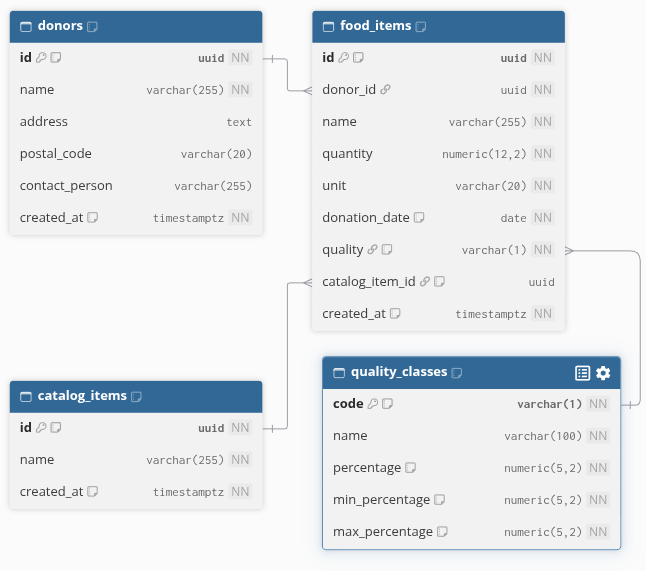

# Quality classes

This table holds the quality classes of donated food, and the share of the price kept for each one when a donation is valued. Every donated food item is linked to one quality class.

## Diagram

The diagram is generated from [quality-classes.dbml](quality-classes.dbml). To update it, paste the content of that file into [dbdiagram.io](https://dbdiagram.io).

The donors, food_items and catalog_items tables come from earlier steps. They are shown in the diagram because food items link to their quality class and to their catalog item.

## Tables

### quality_classes

One row per quality class.

| Column | Meaning |
| --- | --- |
| code | One capital letter from A to Z, such as A, B or C. It identifies the class and never changes. |
| name | Name shown in the app. Two classes cannot have the same name. |
| percentage | Share of the price applied by default, from 0 to 100 |
| min_percentage | Lowest share allowed for this class |
| max_percentage | Highest share allowed for this class |

### food_items

The quality column of food_items now holds the code of a quality class, and must match an existing class. Before this change, a fixed rule only allowed A, B or C. That rule is replaced by the link, so a new class added later can be used without changing the database.

## Initial values

The three classes are created automatically when the database is set up. Their values follow the PRD and **are still to be confirmed with Nafissa**:

| Code | Name | Default | Allowed range |
| --- | --- | --- | --- |
| A | Grocery quality | 100 % | 100 % only |
| B | Imperfect | 50 % | 50 % to 75 % |
| C | Near expiry | 0 % | 0 % only |

Points to confirm with Nafissa:

1. The names of the classes.
2. The range of class B, which the warehouse director sets (50 % to 75 % today).
3. The default for class B. It is set to 50 %, the low end of the range, so a receipt is never overvalued by default.
4. How the percentage of a class B item is chosen. The PRD lists three options: per type of food, at the discretion of the supply team, or a default that can be changed.

Once confirmed, any value can be changed in the table without a new migration, as long as the rules below are kept. The three classes are inserted by the migration only. They are not part of the Entity Framework model (no HasData), so a later migration never overwrites the values the admin has changed. To change the initial values in code, write a new migration that updates the rows on purpose.

## How the percentage is used

The value of a donated item is:

quantity × price of one unit × quality percentage

For example, 12.50 kg of bread at $4.00 in class B at 75 % is worth $37.50.

When a receipt is made, the percentage used is copied onto the receipt line (receipt_items.quality_percent). Changing a quality class later never changes a receipt that already exists.

## Why the class is on the donation

The class is set on each donated item (food_items), not on the type of food in the catalog. The same food can be given in different conditions: one donation of apples can be grade A and the next one grade B.

## Exact percentages

All three percentage columns are exact decimal numbers with 2 decimal places (numeric(5,2)), never approximate numbers:

- 62.50 % is stored exactly as 62.50.
- A third decimal is rounded half away from zero: 66.665 becomes 66.67.
- The database refuses a value that does not fit 3 digits before the decimal point, such as 1000.

## Rules enforced by the database

1. A food item must have a quality class that exists.
2. A quality class cannot be deleted while a food item uses it.
3. The default percentage must be between the lowest and the highest percentage of its class.
4. The lowest percentage cannot be below 0, the highest cannot be above 100, and the lowest cannot be above the highest.
5. Two classes cannot have the same code or the same name.
6. A code is exactly one capital letter from A to Z. A lowercase letter, a digit, a space, a symbol or an accented letter is refused, so B and b can never be two classes.
7. A name cannot be empty.

## Rules left to the app

- When a class B item is valued, the app makes sure the percentage chosen stays within the range of the class. The database checks only that a receipt line's percentage is between 0 and 100.
- Only the admin can change the classes, as the PRD says.

## Migration

| Item | Location |
| --- | --- |
| Entity Framework migration | [20261112060008_CreateQualityClasses](../../src/MoissonMontreal.Api/Data/Migrations/20261112060008_CreateQualityClasses.cs) |
| Equivalent SQL script | [0005_create_quality_classes.sql](sql/0005_create_quality_classes.sql) |
| Table settings | [QualityClassConfiguration.cs](../../src/MoissonMontreal.Api/Data/Configurations/QualityClassConfiguration.cs) and [FoodItemConfiguration.cs](../../src/MoissonMontreal.Api/Data/Configurations/FoodItemConfiguration.cs) |

The migration creates the table and its three classes first, then links food_items to it. A database that already holds food items graded A, B or C is upgraded without losing anything. Rolling the migration back removes the table and puts back the rule that only allows A, B or C.

The rollback first checks that nothing would be lost, and stops with a clear error, before changing anything, when:

- a food item uses a class other than A, B or C, since the old rule would refuse it;
- a class was added, or a name or percentage was changed, since removing the table would delete those values.

To roll back in that case, move those food items to A, B or C and put back the three initial classes first.

The initial classes and this check are written by hand in the migration. Keep them if the migration is ever regenerated.

The SQL script is generated from the migration with `dotnet ef migrations script CreateCatalogItemsAndPrices CreateQualityClasses --project src/MoissonMontreal.Api --output docs/database/sql/0005_create_quality_classes.sql`. It must be run after the scripts 0001 to 0004. It records itself in the migration history, so Entity Framework will not apply it a second time.

The generated file starts with a UTF-8 byte order mark (BOM). Remove it before committing, for example with `sed -i '1s/^\xEF\xBB\xBF//' docs/database/sql/0005_create_quality_classes.sql`.
