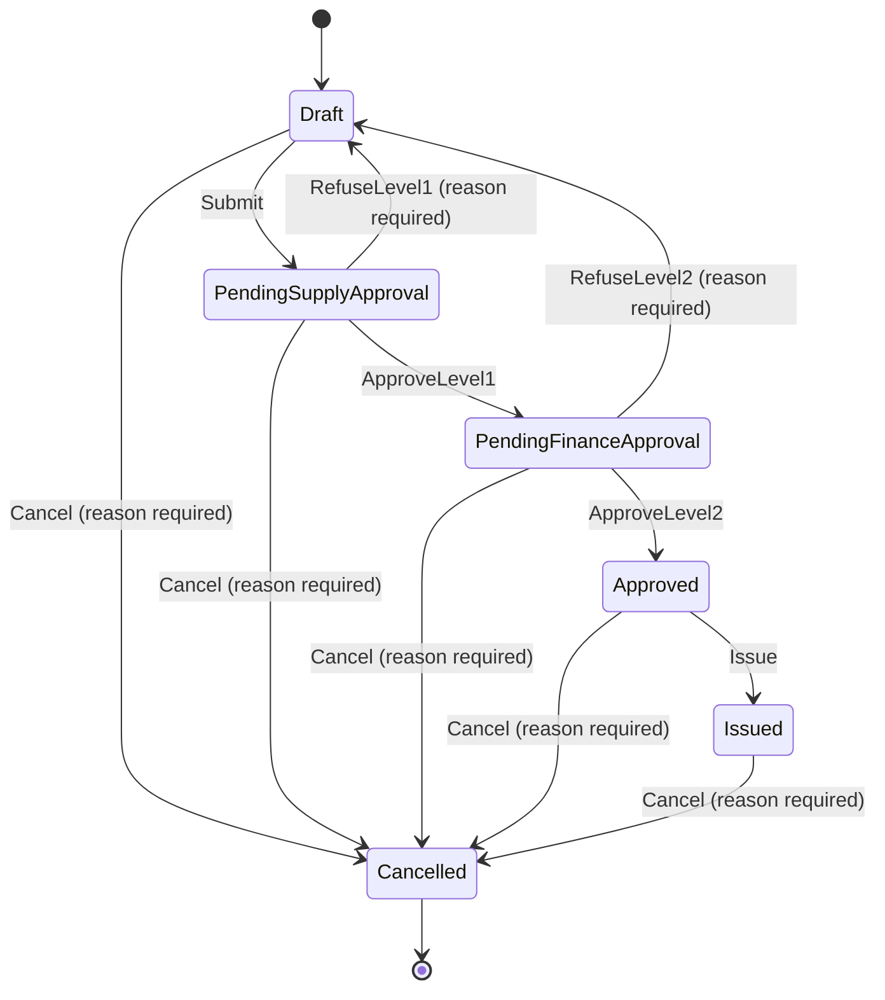

# Receipt statuses

A tax receipt goes through several steps before it reaches the donor: Supply prepares it, the supply director approves it, Finance approves it, then Supply issues it. This page lists the statuses of a receipt, the changes allowed between them, and who can make each change.

The API refuses any change that is not on this page. Hiding a button in the desktop app is only a convenience: the check always happens on the server.

## Diagram

GitHub draws this diagram directly. To edit it elsewhere, paste the block into [mermaid.live](https://mermaid.live).

## Statuses

| Status | Meaning |
| --- | --- |
| Draft | Supply is preparing the receipt. Every new receipt starts here, and a refused receipt comes back here to be corrected. |
| PendingSupplyApproval | Submitted, waiting for the supply director (first level) |
| PendingFinanceApproval | Approved at the first level, waiting for Finance (second level) |
| Approved | Approved at both levels, ready to be issued |
| Issued | Sent to the donor. It does not change anymore, except to be cancelled. |
| Cancelled | Cancelled, with a reason. No change is possible after this. |

## Allowed changes

| Action | From | To | Who can do it | Reason |
| --- | --- | --- | --- | --- |
| Submit | Draft | PendingSupplyApproval | Supply, Supply Director, Admin | |
| ApproveLevel1 | PendingSupplyApproval | PendingFinanceApproval | Supply Director, Admin | |
| RefuseLevel1 | PendingSupplyApproval | Draft | Supply Director, Admin | Required |
| ApproveLevel2 | PendingFinanceApproval | Approved | Finance, Admin | |
| RefuseLevel2 | PendingFinanceApproval | Draft | Finance, Admin | Required |
| Issue | Approved | Issued | Supply, Supply Director, Admin | |
| Cancel | Any status except Cancelled | Cancelled | Supply, Supply Director, Admin | Required |

The roles come from the permissions in [roles-permissions.md](../auth/roles-permissions.md): preparing, issuing and cancelling need "Prepare, issue and generate receipts", and each approval level needs its own permission.

## Rules

1. Only the changes listed above are allowed. For example, a draft cannot be issued, and an issued receipt cannot go back to draft.
2. The employee who submitted a receipt cannot approve it, at either level. If the receipt is refused and submitted again by someone else, that person is the one who cannot approve it.
3. Refusing or cancelling a receipt requires a reason of at most 1000 characters. Spaces around it are removed, and a reason made only of spaces is refused.
4. Every change is saved in the receipt_status_changes table with the status before and after, the employee, the date and time, and the reason. The status and its history are saved together, so one is never saved without the other.
5. If two employees act on the same receipt at the same time, the receipt is locked until the first change is saved. The second action waits, then is checked against the new status and the new submitter: if it is no longer allowed, it gets an error and the employee must reload the receipt.
6. Cancelling a receipt keeps its lines, so the original stays readable, but its food items are free again and can go on a new receipt.

The database also refuses an unknown status, a change without a reason when a receipt is refused or cancelled, and the deletion of a receipt or an employee that appears in the history. See [receipts.md](receipts.md).

## What the API answers

Each action has its own endpoint:

| Action | Endpoint | Body |
| --- | --- | --- |
| Submit | `POST /api/receipts/{id}/submit` | None |
| ApproveLevel1 | `POST /api/receipts/{id}/approve-level-1` | None |
| RefuseLevel1 | `POST /api/receipts/{id}/refuse-level-1` | `{ "reason": "..." }` |
| ApproveLevel2 | `POST /api/receipts/{id}/approve-level-2` | None |
| RefuseLevel2 | `POST /api/receipts/{id}/refuse-level-2` | `{ "reason": "..." }` |
| Issue | `POST /api/receipts/{id}/issue` | None |
| Cancel | `POST /api/receipts/{id}/cancel` | `{ "reason": "..." }` |

| Situation | Answer |
| --- | --- |
| The change is allowed | 200, with the status before and after, the employee, the date, the reason and the actions now possible |
| The change is not allowed from the current status | 409, with a message such as "Issue is not allowed on a receipt in status Draft. Allowed actions: Submit, Cancel.", the current status and the actions possible |
| Someone else changed the status in the meantime, and the action is no longer allowed from the new status | 409 |
| The reason is missing, empty or too long | 400 |
| The employee's role does not allow the action | 403 |
| The employee tries to approve a receipt they submitted | 403 |
| The receipt does not exist | 404 |
| The employee is not signed in | 401 |

## For developers

| Piece | Location | Role |
| --- | --- | --- |
| `ReceiptStateMachine` | `src/MoissonMontreal.Core/Receipts/` | The list of allowed changes, with the permission, the reason and the submitter rule of each one |
| `ReceiptStatusService` | `src/MoissonMontreal.Api/Receipts/` | Applies a change: checks it, then saves the status and the history in one transaction |
| `ReceiptStatusController` | `src/MoissonMontreal.Api/Controllers/` | One endpoint per action, protected by the permission of its change |

To change what is allowed:

1. Update `Transitions` in `ReceiptStateMachine.cs`.
2. Update `AgreedTransitions` in `tests/MoissonMontreal.Tests/Receipts/ReceiptStateMachineTests.cs`. It is kept separate on purpose, so a mistake in one of the two makes the tests fail.
3. Update the diagram and the tables on this page. `ReceiptStatusDiagramTests` fails if the diagram does not match `ReceiptStateMachine`.
4. If a status is added, add a migration: the database only accepts the statuses it knows.
