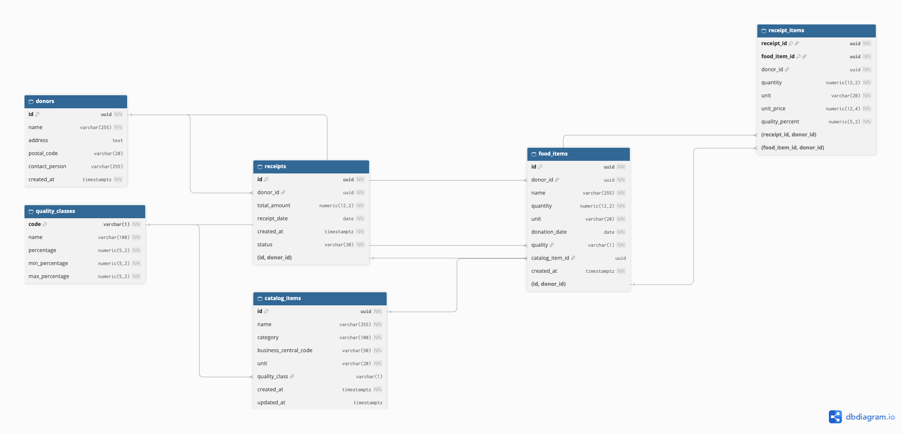

# Receipts and their prices

These tables hold the tax receipts given to donors, the value of each food item on them, and the history of their status. A receipt belongs to one donor and lists the food items that donor gave. For each item, the receipt keeps the quantity, unit, price and quality percentage used to value it, so the amount can always be checked and recalculated, even if the food item is edited later.

## Diagram

The diagram is generated from [receipts.dbml](receipts.dbml). To update it, paste the content of that file into [dbdiagram.io](https://dbdiagram.io).

The donors and food_items tables come from an earlier step. They are shown in the diagram because receipts link to them.

## Tables

### receipts

One row per tax receipt.

| Column | Meaning |
| --- | --- |
| id | Code that identifies the receipt, assigned automatically |
| donor_id | The donor who receives the receipt (see the donors table) |
| total_amount | Total value of the receipt, in dollars and cents. It is the sum of the rounded values of its food items. |
| receipt_date | Date of the receipt in Montreal time, set automatically. This is the date used for the tax year. |
| created_at | Date and time the receipt was created, stored in UTC |
| status | Where the receipt is in the approval process: Draft, PendingSupplyApproval, PendingFinanceApproval, Approved, Issued or Cancelled. A new receipt starts as Draft. |
| receipt_number | Unique number of the receipt, such as DEN_000001. Empty until the receipt is issued, then kept even if the receipt is cancelled. |

### receipt_items

One row per food item on a receipt.

| Column | Meaning |
| --- | --- |
| receipt_id | The receipt this line belongs to |
| food_item_id | The food item valued on this line (see the food_items table) |
| donor_id | The donor of both the receipt and the food item. It makes sure they are the same donor. |
| quantity | Quantity of the food item when the receipt was made, copied from the food item |
| unit | Unit of that quantity, such as kg or case, copied from the food item |
| unit_price | Price of one unit of the item when the receipt was made, in dollars, with up to 4 decimal places. For example, $0.125 per kg. |
| quality_percent | Share of the price kept for the item's quality grade: 100 for grade A, between 50 and 75 for grade B, 0 for grade C |
| receipt_cancelled | Yes once the receipt is cancelled. The line is kept as a record of the cancelled receipt, but the food item can then go on a new receipt. |

### receipt_status_changes

One row every time the status of a receipt changes. Rows are only added, so the history of a receipt is never rewritten.

| Column | Meaning |
| --- | --- |
| id | Code that identifies the change, assigned automatically |
| receipt_id | The receipt whose status changed |
| from_status | Status before the change |
| to_status | Status after the change |
| changed_by_user_id | The employee who made the change (see the users table) |
| changed_at | Date and time of the change, set automatically and stored in UTC |
| reason | Why the receipt was refused or cancelled. Required in those two cases, empty otherwise. |

The status changes that are allowed, and who can make each one, are decided by the API, not by the database. See [Receipt statuses](receipt-statuses.md) for the diagram and the rules.

### receipt_number_counters

The last receipt number given in each series. There is one series for now: DEN, for food donations. The migration creates its row with 0, so the first receipt issued gets DEN_000001. If receipts were issued before the migration, it numbers them first: every receipt whose history shows it was issued, even if it was cancelled since, in the order it was issued.

| Column | Meaning |
| --- | --- |
| series | Name of the series, such as DEN |
| last_number | Last number given in the series |

See [Receipt statuses](receipt-statuses.md#receipt-numbers) for how a number is given.

## How the value is calculated

The value of each food item on a receipt is:

quantity × unit price × quality percentage

The total of the receipt is the sum of these values. For example, a bakery gives 12.50 kg of bread of grade B and 3 cases of apples of grade A:

| Item | Quantity | Unit price | Quality | Value |
| --- | --- | --- | --- | --- |
| Bread | 12.50 kg | $4.00 | 75 % | $37.50 |
| Apples | 3 cases | $2.49 | 100 % | $7.47 |
| Total | | | | $44.97 |

The quantity, unit, unit price and quality percentage are all saved on the receipt itself. If the food item or the price grid changes later, receipts that already exist keep the values they were made with.

All amounts are stored as exact decimal numbers, so no cent is lost along the way.

### Rounding

1. Each line value is rounded to the cent.
2. A value exactly halfway between two cents is rounded away from zero.
3. The total is the sum of the rounded line values, so it always matches the line-by-line detail.

For example, 1 kg × $0.45 × 50 % = $0.225, which gives $0.23.

This is what PostgreSQL's round() does. In .NET, use Math.Round(value, 2, MidpointRounding.AwayFromZero). The default Math.Round(value, 2) rounds half to even and would give $0.22.

### Code

- [DonationValue.cs](../../src/MoissonMontreal.Core/Pricing/DonationValue.cs) holds the formula and the rounding rule above. It does not use the database.
- [DonationValueService.cs](../../src/MoissonMontreal.Api/Pricing/DonationValueService.cs) values one donated food item. It takes the price of its catalog item in effect on the donation date, and the percentage of the quality class of the donation, not the one of the catalog item. When no percentage is given, the default percentage of the class is used, and a percentage outside the range of the class is refused.
- The result lists the quantity, unit, unit price, the date that price started to apply, the quality class, the percentage and the value, so the calculation can be shown line by line and copied onto a receipt.

The value is never guessed. The calculation is refused with a clear error when the food item is not matched to a catalog item, when it has no price on the donation date, or when its unit differs from the unit of the catalog item. Units are compared without regard to upper or lower case, so kg and KG are the same.

Still to confirm with Moisson Montréal:

- How the percentage of a class B item is chosen (see [quality-classes.md](quality-classes.md)). Until then, the default of the class is used unless a percentage is given.
- What to do when the unit of a donation differs from the unit of its price (issue #28). Until then, the calculation is refused.

## Dates and time zones

receipt_date is the date to use for the tax year and on the printed receipt. The database sets it to the current date in Montreal time. A receipt made on December 31 at 8 p.m. in Montreal is dated December 31, even though it is already January 1 in UTC.

created_at is a precise moment, stored and read back in UTC. Convert it to America/Montreal before showing it. The app can save a time with any offset, such as DateTimeOffset.Now, because it is converted to UTC before it is written.

## How the tables are linked

1. Each receipt belongs to exactly one donor. A donor can have many receipts.
2. Each receipt lists its food items through receipt_items.
3. A food item can appear on only one receipt that is not cancelled, so one donation cannot get two valid tax receipts. Once a receipt is cancelled, its food items can go on a new receipt.
4. A receipt can only list food items given by its own donor.

## Rules enforced by the database

1. A receipt must belong to a donor that exists.
2. A donor cannot be deleted while they still have a receipt.
3. A food item cannot be deleted while it is on a receipt.
4. When a receipt is deleted, its lines are deleted with it. The food items themselves are kept.
5. A food item cannot be on two receipts that are not cancelled. This is a partial unique index on food_item_id, limited to lines where receipt_cancelled is no.
6. The food item and the receipt on a line must have the same donor. This is enforced by including donor_id in both links.
7. The total of a receipt cannot be negative. It can be $0, for example when every item is grade C.
8. A quantity must be greater than 0, and a unit cannot be empty.
9. A unit price must be greater than $0.
10. A quality percentage must be between 0 and 100.
11. The status of a receipt, and the statuses in its history, must be one of the six statuses listed above.
12. A change in the history must go from one status to a different one.
13. A change that refuses a receipt (back to Draft) or cancels it requires a reason, and a reason cannot be empty.
14. A receipt cannot be deleted once it has a status change, and an employee cannot be deleted once they changed a status.
15. Two receipts cannot have the same number.
16. An issued receipt must have a number, and a receipt that was never issued (Draft, waiting for approval or Approved) cannot have one. A receipt cancelled after it was issued keeps its number.
17. A receipt number is DEN_ followed by 6 digits.

Because donor_id is part of both links, the app cannot change the donor of a receipt or of a food item once it is saved.

The app, not the database, makes sure that the total matches the sum of the rounded lines.

A cancelled receipt keeps its lines, so the original stays readable. Cancelling a receipt marks its lines with receipt_cancelled in the same transaction as the status change.

## Migration

| Item | Location |
| --- | --- |
| Entity Framework migration | [20261107041912_CreateReceipts](../../src/MoissonMontreal.Api/Data/Migrations/20261107041912_CreateReceipts.cs) |
| Equivalent SQL script | [0003_create_receipts.sql](sql/0003_create_receipts.sql) |
| Table settings | [ReceiptConfiguration.cs](../../src/MoissonMontreal.Api/Data/Configurations/ReceiptConfiguration.cs) and [ReceiptItemConfiguration.cs](../../src/MoissonMontreal.Api/Data/Configurations/ReceiptItemConfiguration.cs) |
| Receipt number migration | [20261127053347_AddReceiptNumbers](../../src/MoissonMontreal.Api/Data/Migrations/20261127053347_AddReceiptNumbers.cs), with [0010_add_receipt_numbers.sql](sql/0010_add_receipt_numbers.sql) and [ReceiptNumberCounterConfiguration.cs](../../src/MoissonMontreal.Api/Data/Configurations/ReceiptNumberCounterConfiguration.cs) |
| Status and history migration | [20261127052039_AddReceiptStatus](../../src/MoissonMontreal.Api/Data/Migrations/20261127052039_AddReceiptStatus.cs), with [0009_add_receipt_status.sql](sql/0009_add_receipt_status.sql) and [ReceiptStatusChangeConfiguration.cs](../../src/MoissonMontreal.Api/Data/Configurations/ReceiptStatusChangeConfiguration.cs) |

The SQL script is generated from the migration with `dotnet ef migrations script CreateDonorsAndFoodItems CreateReceipts --project src/MoissonMontreal.Api --output docs/database/sql/0003_create_receipts.sql`. It must be run after [0001_create_users_and_roles.sql](sql/0001_create_users_and_roles.sql) and [0002_create_donors_and_food_items.sql](sql/0002_create_donors_and_food_items.sql). It records itself in the migration history, so Entity Framework will not apply it a second time.

The generated file starts with a UTF-8 byte order mark (BOM). Remove it before committing, for example with `sed -i '1s/^\xEF\xBB\xBF//' docs/database/sql/0003_create_receipts.sql`.
