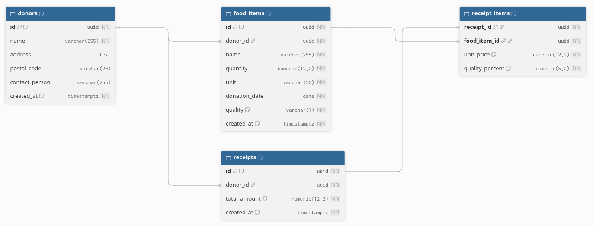

# Receipts and their prices

These two tables hold the tax receipts given to donors and the value of each food item on them. A receipt belongs to one donor and lists the food items that donor gave. For each item, the receipt keeps the price and the quality percentage used to value it, so the amount can always be checked and recalculated.

## Diagram

The diagram is generated from [receipts.dbml](receipts.dbml). To update it, paste the content of that file into [dbdiagram.io](https://dbdiagram.io).

The donors and food_items tables come from an earlier step. They are shown in the diagram because receipts link to them.

## Tables

### receipts

One row per tax receipt.

| Column | Meaning |
| --- | --- |
| id | Code that identifies the receipt, assigned automatically |
| donor_id | The donor who receives the receipt (see the donors table) |
| total_amount | Total value of the receipt, in dollars and cents. It is the sum of the values of its food items. |
| created_at | Date and time the receipt was created |

### receipt_items

One row per food item on a receipt.

| Column | Meaning |
| --- | --- |
| receipt_id | The receipt this line belongs to |
| food_item_id | The food item valued on this line (see the food_items table) |
| unit_price | Price of one unit of the item when the receipt was made, in dollars and cents. For example, the price of 1 kg of bread. |
| quality_percent | Share of the price kept for the item's quality grade: 100 for grade A, between 50 and 75 for grade B, 0 for grade C |

## How the value is calculated

The value of each food item on a receipt is:

quantity of the item × unit price × quality percentage

The total of the receipt is the sum of these values. For example, a bakery gives 12.50 kg of bread of grade B and 3 cases of apples of grade A:

| Item | Quantity | Unit price | Quality | Value |
| --- | --- | --- | --- | --- |
| Bread | 12.50 kg | $4.00 | 75 % | $37.50 |
| Apples | 3 cases | $2.49 | 100 % | $7.47 |
| Total | | | | $44.97 |

The quantity comes from the food item. The unit price and the quality percentage are saved on the receipt itself. If the price grid changes later, receipts that already exist keep the values they were made with.

All amounts are stored as exact decimal numbers, so no cent is lost or rounded along the way.

## How the tables are linked

1. Each receipt belongs to exactly one donor. A donor can have many receipts.
2. Each receipt lists its food items through receipt_items. A food item can appear on more than one receipt, for example when a receipt is replaced later.
3. The same food item cannot appear twice on the same receipt.

## Rules enforced by the database

1. A receipt must belong to a donor that exists.
2. A donor cannot be deleted while they still have a receipt.
3. A food item cannot be deleted while it is on a receipt.
4. When a receipt is deleted, its lines are deleted with it. The food items themselves are kept.
5. The total of a receipt cannot be negative. It can be $0, for example when every item is grade C.
6. A unit price must be greater than $0.
7. A quality percentage must be between 0 and 100.

The app, not the database, makes sure that the food items on a receipt were given by the receipt's donor, and that the total matches the sum of the lines.

## Migration

| Item | Location |
| --- | --- |
| Entity Framework migration | [20261106021712_CreateReceipts](../../src/MoissonMontreal.Api/Data/Migrations/20261106021712_CreateReceipts.cs) |
| Equivalent SQL script | [0003_create_receipts.sql](sql/0003_create_receipts.sql) |
| Table settings | [ReceiptConfiguration.cs](../../src/MoissonMontreal.Api/Data/Configurations/ReceiptConfiguration.cs) and [ReceiptItemConfiguration.cs](../../src/MoissonMontreal.Api/Data/Configurations/ReceiptItemConfiguration.cs) |

The SQL script is generated from the migration with `dotnet ef migrations script CreateDonorsAndFoodItems CreateReceipts --project src/MoissonMontreal.Api --output docs/database/sql/0003_create_receipts.sql`. It must be run after [0001_create_users_and_roles.sql](sql/0001_create_users_and_roles.sql) and [0002_create_donors_and_food_items.sql](sql/0002_create_donors_and_food_items.sql). It records itself in the migration history, so Entity Framework will not apply it a second time.
