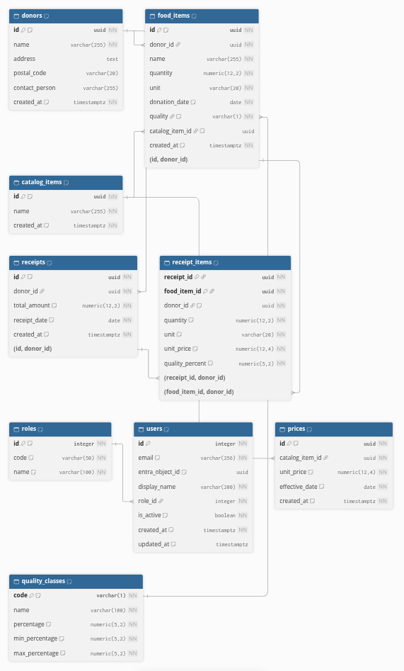

# Database overview

This page explains what the receipt app stores and how the information fits together. It is written for everyone on the project, including people who do not write code.

The database has four parts:

| Part | Tables | What it holds |
| --- | --- | --- |
| Accounts | roles, users | Who can use the app and what each person is allowed to do |
| Donations | donors, food_items, quality_classes | Who gave food, what they gave, when, and in what condition |
| Tax receipts | receipts, receipt_items | The receipts given to donors and the value of each food item on them |
| Price grid | catalog_items, prices | The types of food the app knows, and the price of each one over time |

## Diagram

How to read it:

- Each box is a table, which works like a spreadsheet: one row per record, one column per piece of information.
- A line between two boxes is a link. For example, the line between donors and receipts means that every receipt points to the donor who receives it.
- The boxes are grouped by part: Accounts, Donations, Tax receipts and Price grid.

The diagram is generated from [schema.dbml](schema.dbml). To update it, paste the content of that file into [dbdiagram.io](https://dbdiagram.io) and export the image.

## Tables

### roles

The four roles of the app, one per department: Supply, Supply Director, Finance and Admin. A role decides what a person can see and do. For example, Finance gives the second approval on a receipt. The four roles are created automatically and do not need to be entered by hand.

### users

One row per employee who has access to the app: their work email, their name, their role, and whether their access is still active. Employees sign in with their Microsoft work account, so no password is stored in the app. When someone leaves, the admin deactivates their access instead of deleting them, so the history of who did what is kept.

More detail: [Users and roles](users-roles.md).

### donors

The organizations and people who give food: name, address, postal code and contact person. This is the information printed on the tax receipt. Two donors can have the same name, for example two branches of the same grocery chain.

### food_items

The food given by a donor. Each row holds what the food is, the quantity and its unit (for example 12.50 kg), the date it was received, and its quality class (see quality_classes).

Every food item belongs to one donor and has one quality class. It can also point to its catalog item (see catalog_items), which gives its price. That link stays empty until the donation is matched to the catalog, which is still to come.

### quality_classes

The quality classes of donated food, and the share of the price kept for each one when a donation is valued. The class is set on each donation, not on the type of food, because the same food can be given in different conditions.

| Class | Name | Share of the price kept |
| --- | --- | --- |
| A | Grocery quality: comparable to what a grocery store sells | 100 % |
| B | Imperfect: has imperfections | Between 50 % and 75 %, a range set by the warehouse director. 50 % is applied by default. |
| C | Near expiry: close to its expiry date | 0 %, no value |

These initial values follow the PRD and are still to be confirmed with Nafissa.

More detail: [Quality classes](quality-classes.md).

### receipts

One row per tax receipt. It holds the donor who receives it, the total value in dollars and cents, and the date of the receipt.

More detail: [Receipts and their prices](receipts.md).

### receipt_items

The lines of a receipt, one per food item. Each line keeps a copy of everything used to value the item at the time: the quantity, the unit, the price of one unit and the quality percentage. If a food item or a price is changed later, receipts that already exist do not change.

More detail: [Receipts and their prices](receipts.md).

### catalog_items

The types of food the app knows, such as bread or apples. A donation of bread and the next donation of bread are two different food items, but they share the same catalog item, and so the same price. For now a catalog item only has a name. Its category, Business Central code, unit and quality come with issue #27.

More detail: [Price grid](prices.md).

### prices

The price of one unit of each catalog item, and the date from which it applies. Prices are never replaced: when a price changes, a new row is added with a new effective date, and the earlier prices stay. That way, a past donation can always be valued at the price that applied on the day it was received.

More detail: [Price grid](prices.md).

## How a receipt is valued

The value of each line is:

quantity × price of one unit × quality percentage

The total of the receipt is the sum of its lines. For example, a bakery gives 12.50 kg of bread in grade B and 3 cases of apples in grade A:

| Item | Quantity | Price of one unit | Quality | Value |
| --- | --- | --- | --- | --- |
| Bread | 12.50 kg | $4.00 | 75 % | $37.50 |
| Apples | 3 cases | $2.49 | 100 % | $7.47 |
| Total | | | | $44.97 |

Each line is rounded to the cent, and an amount exactly halfway, such as $0.225, is rounded up to $0.23. The total is the sum of the rounded lines, so it always matches the detail shown on screen.

## How the information is protected

The database itself refuses anything that would break these rules, even if there were a mistake in the app.

**No duplicate receipts**
- A food item can be on only one receipt, so the same donation cannot get two tax receipts.
- The same food item cannot appear twice on one receipt.

**One price per day**
- A catalog item can have many prices over time, but only one price can start on a given day.

**The right donor**
- A receipt can only list food given by its own donor.
- A receipt and a food item always belong to a donor that exists.

**Nothing in use can be deleted**
- A donor cannot be deleted while they have food items or receipts.
- A food item cannot be deleted while it is on a receipt.
- A role cannot be deleted while someone has it.
- A catalog item cannot be deleted while it has prices or while a donation points to it.
- A quality class cannot be deleted while a food item uses it.

**Exact amounts**
- All amounts are stored as exact decimal numbers, so no cent is lost along the way.
- Quality percentages are exact decimal numbers with 2 decimal places, such as 62.50 %, never approximate numbers.
- Prices keep up to 4 decimal places, so a price such as $0.125 per kg is stored exactly.
- Totals and line values are in dollars and cents.

**Valid values**
- A quantity and a price must be greater than zero.
- A quality percentage must be between 0 and 100.
- A food item must have a quality class that exists.
- A quality class keeps a default percentage within its own range, and the range stays between 0 % and 100 %.
- Two quality classes cannot have the same code or the same name, and a code is one capital letter from A to Z.
- A receipt total cannot be negative.
- Donor names, food names, catalog item names and units cannot be empty.

**Accounts**
- Two employees cannot have the same email or the same Microsoft account.
- Emails are stored in lowercase, so the same address cannot be entered twice with different capital letters.

## Dates and times

- **Dates without a time** are stored as plain calendar dates, with no time zone involved. This covers the date a donation was received, the date of a receipt and the date a price starts to apply.
- **The date of a receipt** is set automatically to the current date in Montreal. It decides the tax year. A receipt made on December 31 at 8 p.m. is dated December 31, even though it is already January 1 in universal time.
- **Moments with a time**, such as when an account or a receipt was created, are stored in universal time (UTC) and shown in Montreal time.

## Not built yet

These parts of the project are planned in their own issues and will add tables later:

| Feature | Issue |
| --- | --- |
| Price lookup by date | #25 |
| Food catalog details: category, Business Central code, unit and quality | #27 |
| Calculation of a donation's value | #30 |
| Receipt statuses: prepared, approved at two levels, issued, cancelled and replaced | #31 |
| Receipt numbering, unique and with no gaps | #32 |
| PDF receipt | #40 |

When cancelled and replacement receipts are added, the rule "a food item can be on only one receipt" will be adjusted so that a replacement receipt can list the same food as the receipt it replaces.

## Words used on this page

| Word | Meaning |
| --- | --- |
| Table | A list of records of the same kind, like a spreadsheet tab |
| Column | One piece of information kept for every record, like a spreadsheet column |
| Link | A column that points to a record in another table, such as the donor of a receipt |
| UTC | Universal time, the same everywhere in the world. Montreal is 4 or 5 hours behind it. |

## For developers

Each table comes from one of these migrations:

| Tables | Migration | SQL script | Detailed page |
| --- | --- | --- | --- |
| roles, users | [20261103000127_CreateUsersAndRoles](../../src/MoissonMontreal.Api/Data/Migrations/20261103000127_CreateUsersAndRoles.cs) | [0001_create_users_and_roles.sql](sql/0001_create_users_and_roles.sql) | [users-roles.md](users-roles.md) |
| donors, food_items | [20261105163138_CreateDonorsAndFoodItems](../../src/MoissonMontreal.Api/Data/Migrations/20261105163138_CreateDonorsAndFoodItems.cs) | [0002_create_donors_and_food_items.sql](sql/0002_create_donors_and_food_items.sql) | This page |
| receipts, receipt_items | [20261107041912_CreateReceipts](../../src/MoissonMontreal.Api/Data/Migrations/20261107041912_CreateReceipts.cs) | [0003_create_receipts.sql](sql/0003_create_receipts.sql) | [receipts.md](receipts.md) |
| catalog_items, prices | [20261110175320_CreateCatalogItemsAndPrices](../../src/MoissonMontreal.Api/Data/Migrations/20261110175320_CreateCatalogItemsAndPrices.cs) | [0004_create_catalog_items_and_prices.sql](sql/0004_create_catalog_items_and_prices.sql) | [prices.md](prices.md) |
| quality_classes | [20261112060008_CreateQualityClasses](../../src/MoissonMontreal.Api/Data/Migrations/20261112060008_CreateQualityClasses.cs) | [0005_create_quality_classes.sql](sql/0005_create_quality_classes.sql) | [quality-classes.md](quality-classes.md) |

The SQL scripts must be run in order on an empty database.

Every date and time is converted to UTC before it is written, by [UtcDateTimeOffsetConverter.cs](../../src/MoissonMontreal.Api/Data/UtcDateTimeOffsetConverter.cs), which [MoissonDbContext.cs](../../src/MoissonMontreal.Api/Data/MoissonDbContext.cs) applies to every DateTimeOffset column.

The tests in [SchemaDiagramTests.cs](../../tests/MoissonMontreal.Tests/Docs/SchemaDiagramTests.cs) build an empty database from the migrations and check that every .dbml file in this folder matches it exactly: tables, columns, types, defaults, keys, indexes, checks, links and the roles data. Defaults and checks are compared by their full expression, after PostgreSQL rewrites the diagram's version in its own spelling. dbdiagram.io cannot draw a partial index (an index with a WHERE condition) or an index on an expression, so the tests fail if a migration adds one. When that happens, for example for replacement receipts (#31), describe the condition in the index note and extend the tests. Run them with `dotnet test --filter "FullyQualifiedName~MoissonMontreal.Tests.Docs"`. When a migration changes the schema, update [schema.dbml](schema.dbml), the .dbml of that part, and the images.
