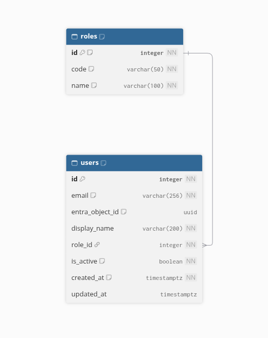

# Users and roles

These two tables control who can open the app and what each person is allowed to do. Every employee who uses the app has one account in the app, linked to their Microsoft work account, and one role that matches their department.

## Diagram

The diagram is generated from [users-roles.dbml](users-roles.dbml). To update it, paste the content of that file into [dbdiagram.io](https://dbdiagram.io).

## Tables

### roles

The list of roles available in the app. The four roles below are created automatically when the database is set up, so there is nothing to enter by hand.

| Role | What it can do |
| --- | --- |
| Supply | Import donations from Business Central, link a donation to a donor, manage donors, prepare a receipt, issue it once approved, generate the PDF |
| Supply Director | Everything Supply can do, plus approve or refuse a receipt (first level) |
| Finance | Approve or refuse a receipt (second level), view the history, export the data |
| Admin | Everything above, plus manage accounts, the price grid and the quality percentages |

| Column | Meaning |
| --- | --- |
| id | Number that identifies the role (1 to 4) |
| code | Short name used by the app to check permissions. It never changes. |
| name | Name shown on screen |

### users

One row per employee who has been given access to the app.

| Column | Meaning |
| --- | --- |
| id | Number that identifies the user, assigned automatically |
| email | Microsoft work email of the employee. Two users cannot share the same email. |
| entra_object_id | Identifier of the employee's Microsoft account. It stays empty until the employee signs in for the first time. |
| display_name | Name shown in the app |
| role_id | The role of the employee (see the roles table) |
| is_active | Yes while the employee has access. Set to no when the admin removes access. |
| created_at | Date and time the access was given |
| updated_at | Date and time of the last change, empty if never changed |

## How the tables are linked

Each user has exactly one role. A role can be given to many users. For example, several people in Finance all share the Finance role.

Passwords are not stored in the app. Employees sign in with their Microsoft work account, which stays managed by the IT team in Microsoft 365.

## Rules enforced by the database

1. A user must have a role, and that role must exist.
2. A role cannot be deleted while a user still has it.
3. Two users cannot have the same email or the same Microsoft account.
4. Emails are always stored in lowercase, so the same address cannot be entered twice with different capital letters.

## Life of an account

1. The admin adds the employee with their work email, name and role.
2. On the first sign-in, the app links the employee's Microsoft account to that row.
3. The admin can change the role at any time.
4. When the admin removes access, the account is deactivated rather than deleted, so the history of who did what is kept.

The very first Admin account cannot be added from the app, since no admin exists yet. It is inserted once directly in the database during the setup on Azure.

## Migration

| Item | Location |
| --- | --- |
| Entity Framework migration | [20261103000127_CreateUsersAndRoles](../../src/MoissonMontreal.Api/Data/Migrations/20261103000127_CreateUsersAndRoles.cs) |
| Equivalent SQL script | [0001_create_users_and_roles.sql](sql/0001_create_users_and_roles.sql) |
| Table settings | [UserConfiguration.cs](../../src/MoissonMontreal.Api/Data/Configurations/UserConfiguration.cs) and [RoleConfiguration.cs](../../src/MoissonMontreal.Api/Data/Configurations/RoleConfiguration.cs) |

The SQL script is generated from the migration with `dotnet ef migrations script 0 CreateUsersAndRoles --project src/MoissonMontreal.Api --output docs/database/sql/0001_create_users_and_roles.sql`. It can be run on an empty Azure Database for PostgreSQL server and records itself in the migration history, so Entity Framework will not apply it a second time.
